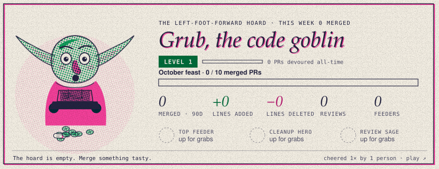

<!-- goblin:links -->
<picture>
  <source media="(prefers-color-scheme: dark)" srcset="docs/card-dark.svg">
  
</picture>

**Visit the Den** · Thank a teammate · Post a bounty · Fund a room (links appear after the first run)
<!-- /goblin:links -->

# Hoard

**A game your organisation plays by working together on GitHub.** There's nothing to tap. Merging, reviewing, commenting and resolving issues earns gold and scrolls. You spend them on GitHub to thank teammates, put bounties on stubborn issues, and build rooms in the goblin's Den that unlock real features for the whole team.

## How it works

**1. Do real work.** Every couple of hours the goblin reads your org's activity and pays the person who did it.

| What you do on GitHub | What you earn |
| --- | --- |
| Get a pull request merged | 1 scroll and 5 gold, plus a little more for bigger changes and extra for deleting code |
| Approve or request changes on someone's pull request | 3 gold (1 for a comment-only review) |
| Leave a comment on an issue or pull request | 1 gold, up to 10 a day |
| Resolve an issue (your merged PR or commit closes it, or you're the assignee) | 1 scroll and 4 gold |
| Start a new repo | 20 gold for the shared treasury |

Bots and AI reviewers never earn. Self-reviews don't count. Comments are capped so nobody can farm them.

**2. Spend it on GitHub.** Each of these is a short issue form. The goblin checks it, moves the gold, replies and closes the issue.

- **Thank a teammate:** send gold with a public note to the thanks wall.
- **Post a bounty:** put gold on an issue. It goes to whoever's merged pull request closes it, and comes back to you if the issue is closed as not planned or the bounty expires.
- **Fund a room:** put scrolls and gold toward the next room in the Den. The treasury matches what you give.

**3. Build the Den together.** Each room unlocks something real:

| Room | Unlocks |
| --- | --- |
| Library | Weekly quests: three team challenges every Monday, with gold for everyone who helps |
| Tavern | The treasury tops up every thanks by 50% (up to 5 gold) |
| Forge | Team banners on the card and in the Den |
| Observatory | A retrospective issue at the start of each month |
| Hall of Fame | Monthly plaques for the top merger, reviewer and most thanked, right here in the README |

The goblin levels up with every scroll the org earns, and grows glasses, headphones, a crown of `{ }` and more as it does.

<!-- goblin:hall -->
<!-- /goblin:hall -->

## Set it up for your organisation

1. Click **Use this template** and create the repo inside your org. Public works on every plan.
2. **Settings → Pages**: deploy from the `main` branch, `/docs` folder.
3. **Give the goblin read access to the org.** The workflow's own token can only see this repo. Pick one:
   - **A GitHub App (recommended):** create an App owned by the org with *Read* on Metadata, Issues, Pull requests and Members, and *Read and write* on Contents and Issues for this repo only. Install it on the org, then add its ID as the repository variable `GOBLIN_APP_ID` and its private key as the secret `GOBLIN_APP_KEY`.
   - **A fine-grained token:** owned by the org, with *Read* on Issues, Pull requests, Metadata and Members for all repositories. Save it as the secret `GOBLIN_TOKEN`.
4. Add a secret called `GOBLIN_SALT` with any long random text. It keeps private activity unguessable in the public ledger.
5. **Actions → Goblin → Run workflow.** The goblin reads the last 30 days and the Den opens.

To show the card on your org profile, add this to `profile/README.md` in your org's `.github` repo:

```html
<a href="https://YOUR-ORG.github.io/YOUR-REPO/"></a>
```

## Settings

Everything lives in [`goblin.config.json`](goblin.config.json).

| Key | Default | What it does |
| --- | --- | --- |
| `name` | `Grub` | The goblin's name |
| `spenders` | `members` | `members`: only org members can spend. `anyone`: anyone who has earned |
| `creditPrivateWork` | `false` | `false`: work in private repos pools into the treasury anonymously. `true`: people earn from it too, shown as amounts only |
| `allowPrivateBounties` | `false` | Allow bounties on issues in private repos (the issue's title is never shown) |
| `maxTransfer` | `100` | Most gold one thanks can send. Bounties allow five times this |
| `thanksPerDay` | `5` | Thanks each person can send per day |
| `bountyExpiryDays` | `60` | Days before an unclaimed bounty is refunded |
| `teams` | each repo | Name your teams, e.g. `{"Platform": ["api", "infra"], "Web": ["web"]}` |
| `rewards` | see file | Every amount in the earning table |
| `roomCostScale` | `1` | Make rooms cheaper (`0.5`) or dearer (`2`) for your org's size |

## How the books are kept

The repo is the bank. Every transaction is one line in an append-only ledger under `docs/data/ledger/`, and every balance, board and card is rebuilt from it on each run. Runs never overlap, nothing is ever spent twice, and anyone can audit the history with `git log`.

## Privacy

This repo and its ledger are public.

- **Never published:** the title, repo, link or author of anything in a private repo.
- **Default:** private work pools anonymously into the treasury.
- **With `creditPrivateWork` on:** people earn from it as a plain daily amount, with no breakdown.
- **Notes are public:** thanks and bounty notes are visible to everyone, and the forms say so.

## Accessibility

- **Contrast:** text and meaningful marks meet WCAG AA in light and dark themes. `node scripts/contrast.mjs` checks every pairing.
- **Keyboard:** the Den works by keyboard.
- **Display settings:** it respects reduced motion, high contrast and forced colours.
- **Card description:** the README card has a written description that updates with the stats.

## Run it locally

```bash
node scripts/goblin.mjs --demo                              # a fake org, no network
GITHUB_TOKEN=$(gh auth token) node scripts/goblin.mjs --org your-org --dry-run
node scripts/test.mjs                                       # the ledger and rules tests
python3 -m http.server 8790 --directory docs                # then open http://localhost:8790
```

No dependencies: Node 20+ and a static file server are all it needs.
